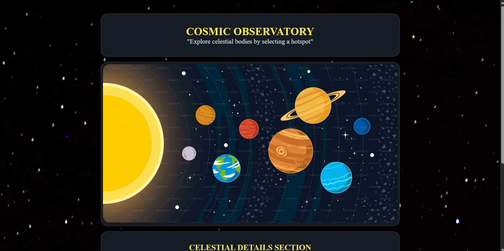

# Interactive Planetarium

A small, static planetarium project for exploring the Solar System. The landing page introduces the project and displays quick facts about the Sun, Earth, and Moon. Select the Solar System image to open a second page, where image-map hotspots link to Wikipedia articles about celestial bodies.

## Features

- A dark, space-themed layout built with HTML and CSS.
- A landing page with quick facts and links for the Sun, Earth, and Moon.
- An interactive Solar System image using HTML `<map>` and `<area>` elements.
- Hotspots for the Sun, Moon, and eight planets, each linking to its Wikipedia article.
- No frameworks, package installation, or build step required.

## Run locally

Open `index.html` in a web browser. To serve the files locally instead, run a static web server from the project directory and open its local URL. No compilation or dependency installation is needed.

## Project files

| File | Purpose |
| --- | --- |
| `index.html` | Landing page, quick facts, and link to the interactive page. |
| `planetarium.html` | Solar System image map and celestial-body links. |
| `style.css` | Styles for the landing page. |
| `app.js` | Empty script file currently included by the landing page; no JavaScript behavior is implemented. |
| `solar-system.avif` | Solar System image used by both pages. |
| `background.jpg` | Space background image. |
| `saturn.png` | Favicon. |

## Credits

The existing project credits the icon to [Magnific on Flaticon](https://www.flaticon.com/authors/magnific) and the imagery to [Unsplash](https://unsplash.com/photos/a-dark-sky-filled-with-countless-stars-o4qEeqSZvWQ).
